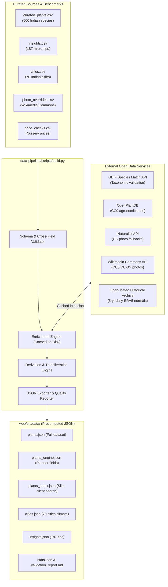
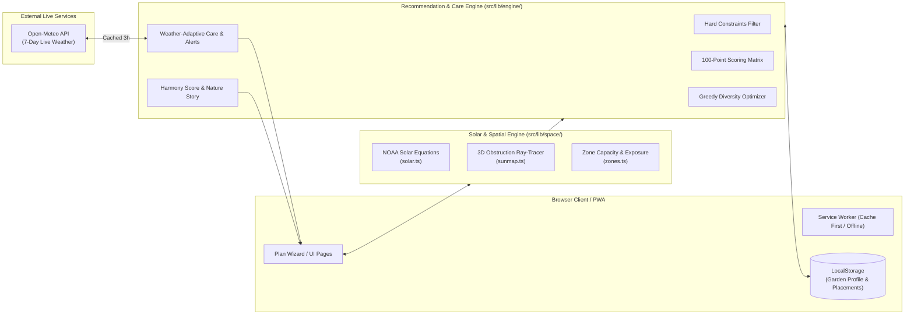

# GreenHarmony AI

> **Climate-Smart Balcony & Terrace Gardens for Indian Urban Homes**  
> *An intelligent micro-ecosystem planner that turns empty concrete balconies into biodiverse, productive urban forests.*

[](https://greenharmony-mu.vercel.app)
[](https://pccoepune.com)
[](https://sdgs.un.org/goals/goal13)
[](file:///d:/Computer%20Programming/Hackathons/Upcomming/Indradhanu/Prototype/web)
[](file:///d:/Computer%20Programming/Hackathons/Upcomming/Indradhanu/Prototype/web)
[](file:///d:/Computer%20Programming/Hackathons/Upcomming/Indradhanu/Prototype/web)

---

## Table of Contents

1. [Project Overview & Hackathon Context](#project-overview--hackathon-context)
2. [The Non-Technical Foundation](#the-non-technical-foundation)
   - [The Problem Statement](#the-problem-statement)
   - [The Core Philosophy: "One Balcony is Small. Thousands are an Urban Forest."](#the-core-philosophy)
   - [Target Audience & User Personas](#target-audience--user-personas)
   - [India-First Design & Cultural Grounding](#india-first-design--cultural-grounding)
   - [Ecological & Climate Impact](#ecological--climate-impact)
3. [Key Features & User Journey](#key-features--user-journey)
   - [1. Spatial Balcony Modeler & NOAA Ray-Tracing Sun Engine](#1-spatial-balcony-modeler--noaa-ray-tracing-sun-engine)
   - [2. Intelligent Multi-Zone Recommendation Engine](#2-intelligent-multi-zone-recommendation-engine)
   - [3. The Living Garden Dashboard](#3-the-living-garden-dashboard)
   - [4. Eco-Impact Calculator & Garden Harmony Score](#4-eco-impact-calculator--garden-harmony-score)
   - [5. Multilingual & Phonetic Vernacular Search](#5-multilingual--phonetic-vernacular-search)
   - [6. Progressive Web App (PWA) & Offline Capability](#6-progressive-web-app-pwa--offline-capability)
4. [System Architecture & Data Flow](#system-architecture--data-flow)
5. [The Entire Tech Stack](#the-entire-tech-stack)
6. [Data Pipeline & Dataset Quality](#data-pipeline--dataset-quality)
7. [Important Instructions: Getting Started & Run Guide](#important-instructions-getting-started--run-guide)
   - [Prerequisites](#prerequisites)
   - [Running the Web Application](#running-the-web-application)
   - [Running the Data Pipeline](#running-the-data-pipeline)
   - [Executing the Automated Test Suite](#executing-the-automated-test-suite)
   - [Building Static Export & PWA Assets](#building-static-export--pwa-assets)
   - [Deployment](#deployment)
8. [Directory Structure](#directory-structure)
9. [The Pune Balcony Demo Case](#the-pune-balcony-demo-case)
10. [Roadmap & Future Vision](#roadmap--future-vision)

---

## Project Overview & Hackathon Context

- **Event:** Indradhanu 2026, PCCOE International Grand Challenge, Pune
- **Theme:** AI for Climate Change (UN SDG 13: Climate Action, SDG 11: Sustainable Cities and Communities)
- **Team:** Team Cultivate
- **Live Production URL:** [https://greenharmony-mu.vercel.app](https://greenharmony-mu.vercel.app)

**GreenHarmony AI** is a climate-adaptive urban gardening system designed specifically for the unique architectural, environmental, and cultural realities of Indian apartment living. Instead of generic single-plant recommendations, GreenHarmony models the 3D geometry of an apartment balcony, computes direct sunlight at every spot via an astronomical ray-tracing engine, and recommends an optimized *combination* of plants that thrive together in layered growing zones.

---

## The Non-Technical Foundation

### The Problem Statement

1. **The Urban Heat Island Effect & Empty Concrete Spaces:** Rapid urban growth in Indian cities (Mumbai, Pune, Delhi, Bengaluru, Hyderabad) has created concrete heat sinks. While millions of apartment balconies, terraces, and windowsills sit bare, they represent collectively thousands of square kilometers of potential urban canopy.
2. **The "Green Thumb" Myth & High Plant Mortality:** Over 70% of urban plant buyers purchase plants on impulse based solely on appearance. Placed in unsuitable light conditions or given inappropriate watering, the plants wither within weeks. Discouraged users conclude they "lack a green thumb" and abandon gardening altogether.
3. **Severe Flaws in Existing Solutions:**
   - **Western Bias:** Existing plant apps rely on USDA hardiness zones, follow North American seasonal calendars, use only English botanical names, and recommend species unavailable in Indian markets.
   - **Unrealistic Sunlight Estimations:** Asking users *"How many hours of sun does your balcony get?"* yields wildly inaccurate answers. Sunlight shifts drastically between seasons (e.g., high summer vs. low winter sun) and varies across a 1.2-meter balcony depth due to overhead roofs and solid railings.
   - **No Living Plan:** Traditional tools give a static list of plants and offer no guidance as weather changes, pests arrive, or seasons transition.

### The Core Philosophy

> *"One balcony is small. Thousands of balconies are an urban forest."*

GreenHarmony reframes urban gardening from a solitary hobby into collective environmental stewardship. When thousands of households establish climate-resilient micro-gardens, the collective impact cools local neighborhoods, establishes ecological corridors for pollinators, reduces storm-water runoff, and sequesters carbon.

### Target Audience & User Personas

| Persona | Needs & Pain Points | How GreenHarmony Solves It |
|---|---|---|
| **Urban Apartment Dwellers** | High-rise flats, limited square footage, windy balconies | Generates layered vertical plans (railings, wall climbers, hanging hooks, floor pots) while reserving seating and walkways. |
| **Working Professionals** | Limited time, erratic schedules, fear of plant death | Recommends low-maintenance, drought-tolerant plants; provides an adaptive today-only watering checklist with rain-skip detection. |
| **Elderly & Traditional Users** | Need sacred and fragrant plants for daily pooja and home remedies | Prioritizes Tulsi, Mogra, Desi Gulab, Parijat, Aparajita, and Kadipatta with full Hindi and Marathi names. |
| **Families with Children** | Safe exploration, educational value, hands-on learning | Kid-friendly gardening filter excludes toxic plants and highlights fast-germinating, tactile crops (touch-me-not, cherry tomatoes, sunflowers). |
| **Kitchen Garden Beginners** | Clean, pesticide-free fresh greens and herbs | Guides sowing timelines for daily culinary staples: coriander, mint, methi, spinach, and green chillies. |

### India-First Design & Cultural Grounding

- **Nursery Market Reality:** Every recommended plant is prioritized by real availability across Indian nurseries (local city plant nurseries, Ugaoo, Nurserylive, Saharanpur nurseries). If a plant cannot be purchased this weekend, it is never prioritized.
- **Multilingual Vernacular Support:** Full support for Indian regional names in both Devanagari and Latin script (*तुलसी / Tulsi*, *मोगरा / Mogra*, *जास्वंद / Jaswand*, *कढीपत्ता / Kadipatta*, *कोथिंबीर / Kothimbir*).
- **Indian Agro-Climatic Calendars:** Planting, peak flowering, and harvest calendars are synchronized with Indian seasonal cycles (Kharif, Rabi, Zaid / monsoon, post-monsoon, winter, summer) across 70 Indian cities.
- **Realistic Indian Rupee (₹) Pricing:** Practical small-nursery cost estimates (typically ₹30–₹250 per sapling) allowing users to budget their garden realistically.

### Ecological & Climate Impact

- **Microclimate Cooling:** Green canopy transpiration reduces ambient balcony temperatures by 1–7 °C, moderating building envelope heat transfer.
- **Rainwater Retention:** Potted soil and canopy intercept intense monsoon downpours, reducing urban storm-water load.
- **Urban Pollinator Highways:** Intentional selection of nectar-rich flowering species provides vital food stations for honeybees, stingless bees, and butterflies across high-density concrete corridors.
- **Localized Food Miles:** Fresh herbs and micro-vegetables harvested meters from the kitchen reduce household packaging and transport footprint.

---

## Key Features & User Journey

```
┌─────────────────┐     ┌──────────────────┐     ┌───────────────────┐     ┌──────────────────┐
│  Balcony Wizard │ ──▶ │ NOAA Sun Studio  │ ──▶ │ Multi-Zone Planner│ ──▶ │  Living Garden   │
│  (8 visual Qs)  │     │ (Ray-trace light)│     │ (6-factor score)  │     │ (Weather/Water)  │
└─────────────────┘     └──────────────────┘     └───────────────────┘     └──────────────────┘
```

### 1. Spatial Balcony Modeler & NOAA Ray-Tracing Sun Engine

Users specify their space in under two minutes without measuring tapes:
- **Location:** Select from 70 Indian cities or detect nearest city for precise solar latitude/longitude and historical climate data.
- **Space Type & Dimensions:** Balcony, terrace, windowsill, or indoor corner with customizable width, depth, and ceiling height.
- **Facing Direction:** 8-point compass orientation (N, NE, E, SE, S, SW, W, NW).
- **Enclosures & Obstructions:**
  - Railing type: grill (partial 60% light transmission), solid wall (0% transmission below sill), glass (85% transmission), or open.
  - Side walls: enclosed on one, both, or neither side.
  - Front obstruction: distance and relative height of opposite apartment buildings or trees.
  - Floor height: wind exposure penalties for floors ≥8 and reduced pollinator visits for floors ≥10.
- **Sun Studio Simulation:**
  - Employs the **NOAA Solar Position Algorithm** to calculate sun altitude and azimuth at 15-minute intervals throughout daylight hours.
  - Traces 3D rays from points across the balcony through the opening envelope.
  - Generates a **12-month solar heatmap** and an interactive **Sun Studio** featuring a time-of-day slider, side cut-away ray tracer, and spot-by-spot sunlight timelines.

### 2. Intelligent Multi-Zone Recommendation Engine

The engine distributes plants across tailored architectural layers rather than treating the balcony as a single pot:
- **Growing Zones:** Railing planters, front floor, back floor, wall trellis for climbers, hanging baskets, vertical plant racks, and windowsills.
- **Constraint Filtering (Hard Rules):** Excludes plants whose minimum sunlight requirements exceed zone exposure, plants that cannot survive the city's temperature extremes, plants toxic to pets/children (if specified), or plants requiring pots larger than zone capacity.
- **100-Point Scoring Matrix:**
  - **Sunlight Fit (25 pts):** Match between seasonal sunlight hours and plant needs.
  - **User Goals (25 pts):** Direct alignment with selected priorities (food, fragrance, flowers, pooja, pollinators, medicinal, privacy, low effort).
  - **Climate Margin (12 pts):** Buffer between local temperature/humidity extremes and plant survival thresholds.
  - **Water Fit (8 pts):** Match with user's available watering schedule and drought resilience.
  - **Market Availability & Popularity (10 pts):** Nursery accessibility across Indian markets.
  - **Experience Level (7 pts):** Matches beginner, intermediate, or experienced gardener profiles.
  - **Plant-able Now (5 pts):** Bonus for plants in their optimal Indian sowing/planting window this month.
  - **Balcony Lifestyle (≤8 pts):** Morning vs. evening balcony usage (morning blooms vs. night-fragrant flowers) and child-friendly plants.
- **Total Transparency:** Users can click any plant to inspect its exact score breakdown ("Why this score?"), swap it for top alternative candidates, or view why other species were excluded.

### 3. The Living Garden Dashboard (`/garden`)

The garden is not a one-off printout; it lives on the user's device:
- **Live 7-Day Weather Integration:** Connects to Open-Meteo's API (cached locally for 3 hours) with automatic offline fallback to 5-year ERA5 climate normals.
- **Hazard Alerts:** Automatic warnings for heatwaves (≥38 °C), heavy monsoon rain (≥20 mm), winter cold snaps (≤8 °C), high wind, and intense UV, specifying affected plants and mitigation steps.
- **Dynamic Watering Schedule:** Computes custom watering intervals per plant based on current temperature, pot volume, zone exposure, and soil drying rates. Automatically marks plants as *Skip (Rain)* if rain is forecast for open zones.
- **Monthly Season Check:** On every visit, the engine recomputes shifting solar angles for the new month, flags plants transitioning into insufficient or excessive sunlight, and suggests optimal spot relocations.
- **Customization & State Persistence:** Mark plants as planted, pin custom swaps, adjust balcony dimensions, or generate a shareable URL to send the garden configuration to friends.

### 4. Eco-Impact Calculator & Garden Harmony Score

Quantifies the environmental contribution of the user's personal garden:
- **Green Area ($m^2$):** Conservative canopy coverage calculation factoring container constraints and vertical wall climber foliage.
- **Water Saved:** Weekly water demand compared to a high-water garden baseline.
- **Biodiversity & Pollinators:** Percentage of nectar-rich, bee-friendly species.
- **Estimated $CO_2$ Uptake:** Annual carbon sequestration estimate range.
- **Garden Harmony Score (0–100):** Holistic index synthesizing Diversity, Sun Fit, Water Efficiency, Biodiversity, Space Utilization, and Sustainability.
- **#EveryPlantCounts Community Ripple:** Visualizes the cumulative ecological multiplier if the user's apartment tower (40 homes) or 1% of the city (10,000 balconies) adopted equivalent greenery.
- **Milestone Unlocks:** Earn badges based on real garden state (*First Sprout, Bee Buddy, Kitchen Gardener, Water Wise, Green Wall, Monsoon Ready*).

### 5. Multilingual & Phonetic Vernacular Search

Users can search 500 species across English, Hindi, and Marathi in either Devanagari or Latin script:
- **Spelling-Tolerant Devanagari Folding:** Strips nuktas, unifies chandrabindu into anusvara, and handles zero-width joiners (e.g., `गुडहल` matches `गुड़हल`).
- **Phonetic Transliteration & Consonant Skeletons:** Normalizes consonants and vowel combinations into phonetic skeletons (e.g., *pudina*, *pudeena*, and *पुदीना* all resolve to skeleton `pdn`; *jaswand*, *kothimbir*, *aliv*, and *tondli* match instantly).

### 6. Progressive Web App (PWA) & Offline Capability

- **Complete Offline Functionality:** Full static pre-rendering (SSG) of all 515 pages.
- **Custom Service Worker (`public/sw.js`):** Employs stale-while-revalidate for static assets, network-first with cache fallback for pages, and an LRU image cache for Wikimedia and iNaturalist plant photography.
- **App-Like Experience:** Installable on Android, iOS Safari, and Desktop Chrome via web manifest and custom install UI.

---

## System Architecture & Data Flow

### 1. Data Pipeline Architecture



### 2. Web Runtime & Interactive Engine Architecture



---

## The Entire Tech Stack

| Category | Technology / Library | Version | Purpose & Rationale |
|---|---|---|---|
| **Frontend Framework** | **Next.js** (App Router, Turbopack) | `16.3.8` | React framework enabling 100% static site generation (SSG) with fast routing and zero server runtime costs. |
| **UI Library** | **React** | `19.2.8` | Component architecture, concurrency, and reactive hooks. |
| **Styling & Design** | **Tailwind CSS** (PostCSS) | `4.x` | Modern utility-first CSS framework with fluid responsive layouts and dark/light mode support. |
| **Iconography** | **Lucide React** | `^1.52.0` | Accessible, clean vector iconography for navigation, zones, weather, and actions. |
| **Language & Typings** | **TypeScript** | `5.x` | Strict type safety across geometry algorithms, plant schemas, and scoring models. |
| **Testing Framework** | **Vitest** | `5.0.3` | High-speed unit, scenario, and property-based test runner (635 tests execute in ~1.4s). |
| **Solar Physics Engine** | Custom NOAA Algorithms | Native TS | Astronomical equations calculating solar declination, hour angles, true solar time (IST), azimuth, and elevation. |
| **Ray-Tracing Engine** | Custom 3D Vector Math | Native TS | Ray-plane and ray-polygon intersection tests evaluating roof overhangs, parapets, side walls, and building skylines. |
| **Live Weather API** | **Open-Meteo Weather API** | Free / Open | 7-day hourly temperature, precipitation probability, wind speed, and UV forecasts (no API key required). |
| **Climate Normals** | **Open-Meteo ERA5 Archive** | 2020–2024 | 5-year historical climate normals for 70 Indian cities used for seasonal planning and offline fallback. |
| **Data Pipeline** | **Python** | `3.10+` | Automated data extraction, taxonomic validation, API enrichment, and phonetic index generation. |
| **HTTP Requests (Python)**| **Requests** | `2.x` | Rate-limited external API querying with disk caching under `cache/`. |
| **Taxonomic Reference** | **GBIF Species Match API** | Open API | Validates 500 botanical names, accepted taxonomic status, and family assignments. |
| **Cultivar & Traits Data** | **OpenPlantDB** | CC0 | Database of 26,500+ cultivar records cross-checking germination, spacing, and maturity timelines. |
| **Image Sources** | **Wikimedia Commons & iNaturalist**| CC-BY / CC0 | Open-licensed plant photography verified for commercial reuse with explicit photographer attribution. |
| **Progressive Web App** | Custom Service Worker | Custom | Pre-caches 30 static bundles, manages offline navigation fallback, and provides persistent photo caching. |
| **Deployment & CDN** | **Vercel** | Edge Network | Static edge hosting with custom immutable caching headers (`vercel.json`). |

---

## Data Pipeline & Dataset Quality

The plant dataset is layered into four distinct tiers:
1. **L0 Hand-Curated Core (`sources/curated_plants.csv`):** 500 species verified against Indian nursery availability, ICAR agricultural guidelines, and state university crop calendars. Includes vernacular names, price bands in ₹, light/water bounds, container depths, and growth habits.
2. **L1 Taxonomic Validation (GBIF):** 100% (500/500) matched with accepted botanical nomenclature.
3. **L2 Trait Cross-Checking (OpenPlantDB):** 450 matched species cross-checking harvest days and container spacing.
4. **L3 Photographic Verification:** 500/500 images verified under CC0, CC-BY, CC-BY-SA, or public domain licenses, with pinned Wikipedia article overrides to avoid inaccurate lead images.

### Dataset Health Summary

```
Total Plant Species:        500
Total Micro-Insights:       187
Botanical Families:         108
Indian Cities Mapped:       70
Beginner-Friendly Species:  333 (66.6%)
Edible / Culinary Crops:    198 (39.6%)
Commercial Photo Licences:  500 (100%)
GBIF Taxonomic Matches:     500 (100%)
Automated Data Lint Errors: 0
```

---

## Important Instructions: Getting Started & Run Guide

### Prerequisites

Ensure you have the following installed on your machine:
- **Node.js**: `v18.0.0` or later (tested on Node 20 / 22)
- **npm**: `v10.0.0` or later
- **Python**: `3.10` or later (with `pip`)
- **Git**

---

### Running the Web Application

The web application resides in `web/`:

```bash
# 1. Navigate to the web folder
cd web

# 2. Install dependencies
npm install

# 3. Start local development server
npm run dev
```

Open [http://localhost:3000](http://localhost:3000) in your browser.

---

### Running the Data Pipeline

The data pipeline resides in `data-pipeline/`:

```bash
# 1. Navigate to the data pipeline folder
cd data-pipeline

# 2. Install required Python packages
pip install requests

# 3. Run full build (validates sources, queries APIs, builds JSON, copies to web/src/data/)
python scripts/build.py

# Alternative: Fast offline build (uses existing cache in cache/, zero network calls)
python scripts/build.py --offline

# Alternative: Skip enrichment (re-validates and re-exports existing derived data)
python scripts/build.py --skip-enrich

# Alternative: Refresh a specific API cache source (e.g. gbif, inat, inat_taxon, opdb)
python scripts/build.py --refresh inat_taxon
```

---

### Executing the Automated Test Suite

GreenHarmony includes **635 automated tests** covering solar physics, engine rules, property tests across 400 random balconies, edge-case scenarios, weight sensitivity, and multilingual search.

```bash
# From the web/ directory
npm test
```

#### Test Suite Breakdown

| Test File | Tests | What is Tested |
|---|---|---|
| `src/lib/space/space.test.ts` | 11 | NOAA sun azimuth and altitude in IST, solstice/equinox sun shifts, terrace parapet shading, opening light transmission. |
| `src/lib/engine/engine.test.ts` | 15 | Hard exclusion rules, pot size constraints, child/pet safety filters, monsoon rain watering rules, climate margins. |
| `src/lib/search.test.ts` | 188 | Multilingual search, Devanagari folding (nukta/chandrabindu), Romanized transliteration, consonant skeletons. |
| `src/lib/engine/quality.test.ts` | 421 | Property tests across 400 random balconies across all 12 months; extreme climate scenarios (Shimla frost, Jodhpur heat); weight sensitivity. |

---

### Building Static Export & PWA Assets

To compile the production static build (515 pre-rendered HTML/JSON pages in `web/out/`):

```bash
# From the web/ directory
npm run build
```

This command runs `next build` followed automatically by `postbuild` (`scripts/finalize-sw.mjs`), which calculates SHA-256 hashes of all compiled assets and injects them into the Service Worker cache manifest (`out/sw.js`).

To regenerate PWA maskable icons and favicons from the SVG logo:

```bash
npm run icons
```

---

### Deployment

The static build can be deployed to any static host (Vercel, Netlify, Cloudflare Pages, GitHub Pages, or AWS S3/CloudFront).

To deploy directly to Vercel production:

```bash
# From the web/ directory
npm run deploy
```

*(Requires a one-time `npx vercel login`)*.

---

## Directory Structure

```
Prototype/
├── README.md                      # Master Project Documentation (This File)
├── data-pipeline/                 # Python Data Pipeline & Enrichment Engine
│   ├── cache/                     # Disk cache for external API payloads
│   ├── output/                    # Generated JSON outputs & reports
│   │   ├── cities.json            # 70 Indian cities with ERA5 monthly normals
│   │   ├── insights.json          # 187 contextual gardening insights
│   │   ├── plants.json            # Full 500-plant database
│   │   ├── plants_engine.json     # Compact schema for recommendation engine
│   │   ├── plants_index.json      # Slim client-side search index
│   │   ├── stats.json             # Aggregate dataset statistics
│   │   └── validation_report.md   # Automated data quality & lint report
│   ├── scripts/
│   │   └── build.py               # Main pipeline script (1,000+ lines)
│   ├── sources/
│   │   ├── cities.csv             # 70 Indian cities with lat/long
│   │   ├── curated_plants.csv     # Hand-curated primary dataset (500 species)
│   │   ├── insights.csv           # 187 categorized micro-tips
│   │   ├── photo_overrides.csv    # Pinned high-quality Wikimedia image links
│   │   └── price_checks.csv       # Verified real-world nursery price checks
│   ├── DATA_SOURCES.md            # Sourcing methodology, schema & quality rules
│   └── README.md                  # Pipeline specific instructions
│
└── web/                           # Next.js 16 Web Application & Engine
    ├── public/                    # Static assets & PWA files
    │   ├── icon-192.png           # PWA icon 192x192
    │   ├── icon-512.png           # PWA icon 512x512
    │   ├── icon-maskable-512.png  # PWA maskable icon 512x512
    │   ├── sw.js                  # Production Service Worker
    │   └── vercel.json            # Caching & security headers
    ├── scripts/
    │   ├── deploy.mjs             # Vercel deployment automation
    │   ├── finalize-sw.mjs        # Postbuild Service Worker asset hasher
    │   └── make-icons.mjs         # SVG icon rasterizer
    ├── src/
    │   ├── app/                   # App Router pages (515 static pages)
    │   │   ├── garden/            # /garden - The Living Garden Dashboard
    │   │   ├── insights/          # /insights - Searchable tips catalog
    │   │   ├── offline/           # /offline - Offline fallback screen
    │   │   ├── plan/              # /plan - Balcony Geometry Wizard
    │   │   ├── plants/            # /plants & /plants/[slug] (500 detail pages)
    │   │   ├── sources/           # /sources - Data and photo credits
    │   │   ├── layout.tsx         # Root layout with header, footer & nav
    │   │   ├── manifest.ts        # Dynamic Web App Manifest
    │   │   └── page.tsx           # Home landing page with live demo story
    │   ├── components/            # Modular React components
    │   │   ├── garden/            # Dashboard, GardenScore, EveryPlantCounts
    │   │   ├── insights/          # InsightTicker, Loader, RouteToasts
    │   │   ├── plan/              # PlanWizard step-by-step controls
    │   │   ├── plants/            # PlantCard, Filters, InSeasonNow, Rails
    │   │   └── space/             # SunStudio, SkyView, SunHeatmap, Compass
    │   ├── data/                  # Precomputed JSON mirrored from pipeline
    │   └── lib/                   # Core business logic & algorithms
    │       ├── engine/            # Recommendation, Care, Impact, Weather
    │       ├── space/             # Solar equations, Ray-tracing, Zones
    │       ├── client-data.ts     # Client-safe slim data loaders
    │       ├── data.ts            # Server-only full data access
    │       ├── search.ts          # Multilingual phonetic search engine
    │       └── site.ts            # Site configuration & metadata constants
    ├── package.json               # NPM scripts and dependencies
    ├── tsconfig.json              # TypeScript configuration
    └── vitest.config.ts           # Vitest testing configuration
```

---

## The Pune Balcony Demo Case

To verify the recommendation engine against real-world Indian conditions, the prototype reproduces the reference case study:

- **Space:** 1.8 m × 1.2 m apartment balcony in Pune, Maharashtra.
- **Orientation & Sunlight:** East-facing, covered roof, grill railing, receiving ~4 hours of direct morning sunlight.
- **Water Availability:** Low watering frequency (suited for busy professionals).
- **Engine Recommendation:**
  - **Railing:** Marigold (*Genda*) & Mint (*Pudina*) — compact root systems, high morning sun utilization, natural pest repellent.
  - **Front Floor Pots:** Desi Rose (*Gulab*) & Tulsi (*Shyam Tulsi*) — sacred, aromatic, thriving in container pots.
  - **Wall Trellis:** Aparajita (*Clitoria ternatea*) — vertical climber producing vibrant blue flowers for pooja.
  - **Hanging Basket:** Ajwain Leaf / Indian Borage — heat-tolerant succulent foliage spilling over baskets.
- **Why this works:** Fits container dimensions, survives Pune summer heat, conserves water, supports urban honeybees, and satisfies fragrance, culinary, and sacred preferences.

---

## Roadmap & Future Vision

- [ ] **Phase 3.1: Computer Vision Balcony Scanner:** Upload a photo of your balcony or window to automatically estimate dimensions, railing transparency, and overhang geometry using multimodal vision models.
- [ ] **Phase 3.2: Automated WhatsApp & Push Care Reminders:** Proactive morning WhatsApp alerts for scheduled waterings and incoming storm/heatwave warnings.
- [ ] **Phase 3.3: Multimodal Gardening AI Assistant:** Voice-driven conversational assistant in Hindi and Marathi for troubleshooting yellowing leaves, nutrient deficiencies, and organic pest remedies (neem oil sprays, wood ash).
- [ ] **Phase 3.4: Neighborhood Seed & Sapling Exchange:** Hyper-local housing society network for sharing extra cuttings, heirloom seeds, and homemade compost.

---

## License & Credits

- **Code:** Developed by **Team Cultivate** for **Indradhanu 2026**.
- **Data & Taxonomy:** [GBIF (Global Biodiversity Information Facility)](https://www.gbif.org/), [OpenPlantDB](https://github.com/cwfrazier1/openplantdb).
- **Weather & Climate:** [Open-Meteo](https://open-meteo.com/) (ERA5 Reanalysis and Forecast Models).
- **Photographs:** Contributed by Wikimedia Commons and iNaturalist photographers under open CC0, CC-BY, and CC-BY-SA licenses. Individual credits and links are documented on every plant page and on `/sources`.
